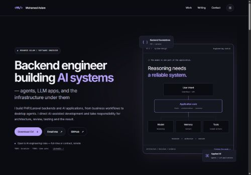
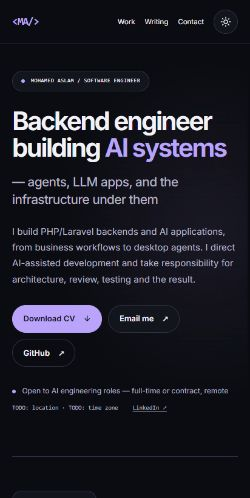

# Mohamed Aslam — backend and AI systems

A hiring portfolio for PHP/Laravel backend work and applied AI projects. It leads from a concise introduction to three editable case studies: Freya-v1, Forge and HireAI.

[Live website](https://mohamedaslam.dev/) · [GitHub](https://github.com/aslamwebz) · [LinkedIn](https://www.linkedin.com/in/aslamwebz/)

The `rework/portfolio` branch combines the earlier site's bold violet styling with the newer system diagrams and case-study structure. It is a review branch; publishing requires the content and hosting checks in the [rework report](docs/rework-report.md).

| Desktop | Mobile |
| --- | --- |
|  |  |

[All four responsive screenshots](docs/screenshots/) · [Approved design](docs/balanced-design.md)

## Stack

| Layer | Version |
| --- | --- |
| PHP | `~8.4.27 \|\| ^8.5.12`; Composer platform `8.4.27` |
| Laravel / Fortify / Filament | 13.38.0 / 1.41.0 / 5.10.3 |
| Inertia PHP / React adapter | 3.5.2 / 3.9.1 |
| React | 19.3.1 |
| TypeScript | 6.0.3; 7 held back until the required ESLint integration supports it |
| Tailwind / Vite | 4.3.3 / 8.3.5 |
| Pest / Laravel plugin | 5.3.3 / 5.0.1 |
| Node | 24.22.1 LTS |

See the [complete before/after dependency table and migration notes](docs/dependency-upgrades.md).

## Fresh local setup

Requires the PHP extensions checked by Composer, PHP GD with WebP support, Composer, Node 24.22.1+ within 24.x, and npm. These commands are for a new checkout; do not run setup against an existing production environment.

```sh
git clone https://github.com/aslamwebz/Portfolio-26.git
cd Portfolio-26
composer run setup
php artisan db:seed
composer run dev
```

The example configuration uses SQLite. Setup creates the environment/key and migrates the database; seeders add initial projects and draft articles without truncating existing rows. Subsequent project seeding preserves owner edits and deletions. New sample articles are drafts.

For a fresh local admin, create your own account interactively with `php artisan make:filament-user`, then grant that exact account access with `php artisan portfolio:grant-admin your-email@example.com`. The command never creates accounts or guesses credentials. Registration is disabled; the admin is at `/admin`.

## Content editing

Filament edits projects, certificates, articles and site settings. Case studies support decisions/trade-offs, results, markdown, a local architecture image, repository/demo/video links and a flagship flag.

Site settings control the CV path, contact/social links, availability, location and time zone. The default CV is the existing `public/Resume.pdf`; review or replace it before publishing this rework. Missing CVs remove the download button gracefully. Existing project images use smaller WebP previews when available, with the originals retained; missing images use diagrams. Client and SSR builds regenerate the legacy previews automatically, and the local Inter web-font subset retains the weights used by the design.

All `TODO:` and `TODO-VERIFY:` items are deliberate factual review markers, listed in the report. Employer projects remain anonymous. Only the public Freya-v1 repository is linked; private continuation features are not silently attributed to it.

## Verification

```sh
composer test
php vendor/bin/pint --test
composer audit
php artisan wayfinder:generate --with-form
npm run lint
npm run types
npm run format:check
npm run build
npm run build:ssr
npm audit --audit-level=high
```

Wayfinder generation is needed before static checks in a clean checkout. Both CI workflows use Node from `.nvmrc` and PHP 8.4. CI lint does not modify files.

For a production-style local preview, build SSR, start `php artisan inertia:start-ssr` in a separate terminal, then serve Laravel and verify `php artisan inertia:check-ssr`. The renderer binds to `127.0.0.1:13714`. The [measurement report](docs/rework-report.md) distinguishes plain PHP serving from a compressed OPcache preview; local scores do not certify production hosting.

## Deployment

The document root is `public/`. After review, use `deploy.sh` in an environment with a compatible PHP runtime, Node 24, `proc_open`, and persistent SSR process support. The script checks platform requirements, builds client/SSR assets, applies additive migrations, requires an authorized owner, seeds initial case content once, refreshes caches and verifies the replacement SSR process before leaving maintenance mode.

The first rollout needs a controlled owner bootstrap: apply the additive migrations, authorize the exact existing owner account, and confirm `php artisan portfolio:grant-admin --check` succeeds. The script intentionally fails if no owner is authorized. Back up the database before any production migration. Use a process supervisor for reliable SSR restarts.

Apache/LiteSpeed rules request text compression and immutable caching for fingerprinted assets. Confirm those headers on the actual host. Confirm Hostinger's displayed vendor-patched PHP build satisfies the unchanged Composer security floor; do not bypass platform checks.

This branch must not be merged or deployed until the factual placeholders, CV and hosting prerequisites have been reviewed.

## License

Application code is MIT licensed; see [LICENSE](LICENSE). Personal CV/certificate/photo assets are not relicensed by that software license. Bundled Inter font software retains its [SIL Open Font License](resources/fonts/OFL.txt).
